<div align="center">
  
</div>

<br />

## `~/sobre`

```bash
igor@dev:~$ whoami
> dev em início de carreira · Python & JavaScript

igor@dev:~$ cat prioridades.txt
> código simples · funcional · atenção aos detalhes · foco no usuário

igor@dev:~$ cat objetivo.txt
> crescer como dev e conquistar a primeira vaga júnior, construindo
> ferramentas que eu mesmo usaria no dia a dia

igor@dev:~$ echo $MASCOTE
> 🐍
```
## `~/contato`

<p>
  <a href="https://www.linkedin.com/in/igor-de-souza-branco-b68630314/"></a>
  <a href="mailto:igordesouzabranco@gmail.com"></a>
  <a href="https://portifolioigordesouza.netlify.app/"></a>
  <a href="https://xp-portfolio-igorbranco.netlify.app/"></a>
</p>

## `~/stack`

<p>
  <br />
  <br />
  <br />
  
</p>

<br />

## `~/projetos`

### ▸ destaques

<table>
  <tr>
    <td width="33%" valign="top">
      <h3>🐍 <a href="https://github.com/igordesouzabranco/snakit-cli">snakit</a></h3>
      <p>CLI que cria projetos a partir de templates (Express MVC, React com Vite, Node puro e mais) e sugere mensagens de commit no padrão Conventional Commits lendo o <code>git diff --staged</code>. Hoje tem comandos para lint, changelog, release e hooks.</p>
      <p>Funciona offline e de graça. A IA (<code>--ai</code>) é opcional e, se falhar, ele volta para as regras locais.</p>
      <p><sub><code>Node.js</code> · <code>CLI</code> · <a href="https://www.npmjs.com/package/snakit"><code>npx snakit</code></a></sub></p>
    </td>
    <td width="33%" valign="top">
      <h3>🎓 <a href="https://github.com/igordesouzabranco/collegium-api">Collegium API</a></h3>
      <p>API REST de gestão universitária: cursos, disciplinas, turmas, professores, alunos, avaliações, notas e presença, com 10 recursos e 3 perfis de acesso (administrador, coordenador e professor) via JWT.</p>
      <p>Regras de negócio na camada de serviço, boletim do aluno com médias e frequência, e lançamento de notas e chamada em lote dentro de transação.</p>
      <p><sub><code>Node.js</code> · <code>Express</code> · <code>Sequelize</code> · <code>MariaDB</code> · <code>JWT</code></sub></p>
    </td>
    <td width="33%" valign="top">
      <h3>📦 <a href="https://github.com/igordesouzabranco/origo-api">Origo API</a></h3>
      <p>Meu primeiro projeto em Java: uma API REST de produtos com Spring Boot, validação, tratamento global de erros, Swagger e deploy com Docker.</p>
      <p>Também expõe as operações como ferramentas MCP, para que agentes de IA gerenciem o estoque por conversa.</p>
      <p><sub><code>Java 21</code> · <code>Spring Boot</code> · <code>PostgreSQL</code> · <code>MCP</code> · <a href="https://origo-api.onrender.com/swagger-ui.html">demo</a></sub></p>
    </td>
  </tr>
</table>

### ▸ outros

<table>
  <tr>
    <td width="50%" valign="top">
      <h3>🖥️ <a href="https://github.com/igordesouzabranco/igor-portfolio">igor-portfolio</a></h3>
      <p>Meu portfólio rodando de verdade no terminal, com menu interativo e uma cobra em ASCII. Sem dependências, só Node puro e códigos ANSI.</p>
      <p><sub><code>Node.js</code> · <code>npx igor-portfolio</code></sub></p>
    </td>
    <td width="50%" valign="top">
      <h3>💸 <a href="https://github.com/igordesouzabranco/Jogo-Fugindo-das-dividas-Senac">Fugindo das Dívidas</a></h3>
      <p>Jogo educativo de sobrevivência financeira feito para o SENAC. Tem backend com API e Postgres, que guarda as pontuações, e uma imagem PNG para o jogador compartilhar o resultado.</p>
      <p><sub><code>JavaScript</code> · <code>API</code> · <code>PostgreSQL</code></sub></p>
    </td>
  </tr>
  <tr>
    <td width="50%" valign="top">
      <h3>🤖 <a href="https://github.com/igordesouzabranco/automescommits">automescommits</a></h3>
      <p>Minha primeira automação: todo dia 1º um GitHub Action junta meus commits do mês e o Make publica o resumo no LinkedIn, com uma cobra sorteada de brinde.</p>
      <p><sub><code>GitHub Actions</code> · <code>Node.js</code> · <code>Make</code></sub></p>
    </td>
    <td width="50%" valign="top">
      <h3>📅 AgendaJS</h3>
      <p>App web de agenda em Node.js e Express, com EJS, MongoDB, sessões e proteção contra CSRF, construído enquanto eu estudava o ciclo completo de uma aplicação.</p>
      <p><sub><code>Express</code> · <code>EJS</code> · <code>MongoDB</code></sub></p>
    </td>
  </tr>
</table>

<sub>O resto está nos <a href="https://github.com/igordesouzabranco?tab=repositories">repositórios</a>.</sub>

<br />


## `~/stats`

<p align="center">
  
</p>

<br />

## `~/agora`

```yaml
estudando:
  - Técnico em Desenvolvimento de Sistemas (SENAC)
  - CS50
  - JavaScript & TypeScript
  - PHP
trabalhando: jovem aprendiz na Appmax
construindo:
  - snakit, evoluindo comando por comando
  - automações com GitHub Actions + Make
  - portfólios (um no terminal, um em site e outro com cara de Windows XP)
```

<br />

## `~/.config/igor`

```toml
[setup]
terminal-first = true
linux          = "curioso por Arch + Hyprland"
hardware       = "retro handhelds, upgrades e gambiarras"

[fora-do-codigo]
jogos      = ["League of Legends (Mono Bel'veth)", "Plague Tale", "Hellblade"]
```

<br />


<div align="center">

<sub>Psiu! Rode isso no terminal e conheça meu portfólio por dentro. 🐍</sub>

```bash
igor@dev:~$ npx igor-portfolio
```


<br />

<sub>📍 Brasil (GMT-3) · Ele/Dele · Licença MIT</sub>

</div>
